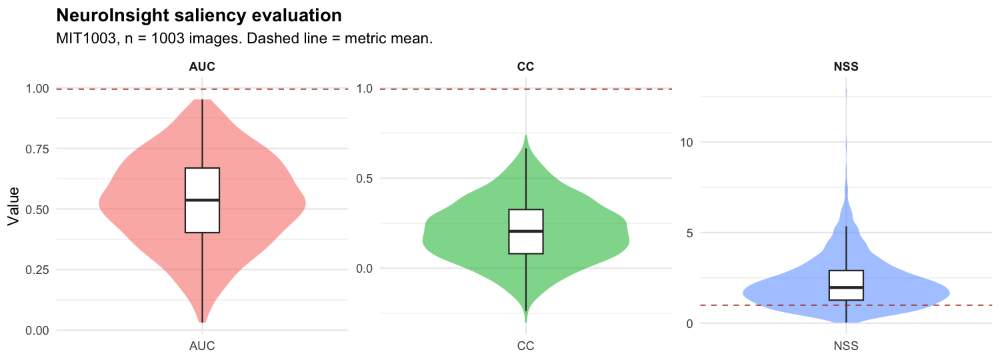
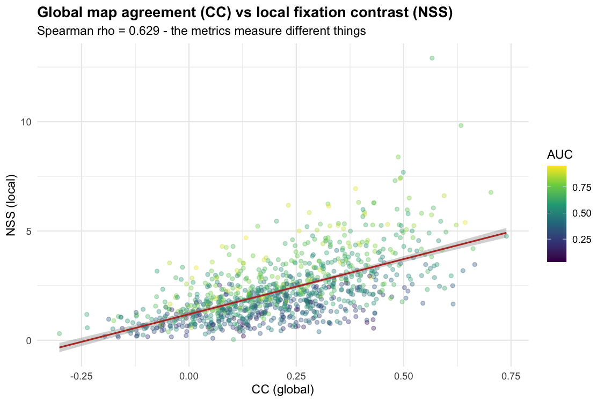

# Evaluation

**Status: real measured results on 1,003 images. Run 12 Oct 2026.**

Reproduce with:

```bash
bash scripts/fetch_eval_data.sh                              # once, ~235 MB
uv run python -m neuroinsight.eval.benchmark                 # ~2.5 min
Rscript analysis/evaluate.R                                  # statistics + figures
```

---

## Dataset

**MIT1003** — Judd, Ehinger, Durand & Torralba (ICCV 2009),
*"Learning to Predict Where Humans Look."*
1,003 natural photographs, eye-tracking from **15 viewers** per image.
<https://people.csail.mit.edu/tjudd/WherePeopleLook/>

**Ground truth used:** the authors' precomputed `*_fixMap.jpg` fixation-density maps.

⚠️ **This is a weaker ground truth than the raw fixation coordinates.** The archive
ships maps that are *already Gaussian-blurred*, and exact (x, y) fixation points are
not available from this distribution. We recover approximate fixation locations from
those maps via local-maxima extraction, then score against them. The consequence:
our AUC is **not directly comparable** to published canonical benchmark scores,
which usually use the raw coordinates. We state this rather than quietly quoting
literature numbers we could not reproduce.

## Model under test

OpenCV Spectral Residual + Fine-Grained — Hou & Zhang, CVPR 2007.
Unchanged from the shipping app. No tuning against this dataset.

---

## Results (n = 1,003)

| Metric | Mean | SD | 95% CI | Median | IQR | Chance |
|:---|---:|---:|:---|---:|:---|---:|
| **AUC** | 0.532 | 0.187 | [0.521, 0.544] | 0.537 | [0.40, 0.67] | 0.500 |
| **CC** | 0.208 | 0.174 | [0.198, 0.219] | 0.205 | [0.08, 0.33] | 0.000 |
| **NSS** | 2.243 | 1.409 | [2.156, 2.330] | 1.965 | [1.27, 2.90] | 0.000 |



### Reading these honestly

**AUC 0.532 is barely above chance.** 53% of images score ≤ 0.55. Only 28.4% exceed
0.65. We are **not** going to describe this as a good AUC.

**CC 0.208 is a genuine, positive correlation** — the predicted map's overall shape
does track where people looked.

**NSS 2.243 is the strongest result.** NSS > 1 already means above chance, and > 2 is
the conventional threshold for a "good" saliency model. At the fixation locations
themselves, our predicted saliency is on average 2.2 standard deviations above the
map's own mean.

### The apparent contradiction

AUC says "near chance"; NSS says "good". This is not a bug — **the metrics measure
different things**, and that disagreement is itself the finding:

- **NSS** asks: *at the pixels people looked at, is our saliency high?* (local contrast)
- **AUC** asks: *across the whole image, do we rank fixated pixels above everything
  else?* (global discrimination, and it is dominated by the millions of flat
  background pixels that dilute the ratio)

A method that fires correctly on fixations but is also somewhat elevated elsewhere
scores well on NSS and poorly on AUC. Our spectral-residual model does exactly that:
it responds to high-contrast regions, which is often right but sometimes just
high-contrast rather than fixated.

Spearman ρ(CC, NSS) = **0.629** confirms CC and NSS are correlated but far from
redundant — reporting either alone would misrepresent the result.



### Distribution

All three metrics are **non-normal** (Shapiro–Wilk p < 0.05 for all; NSS strongly
right-skewed, skewness +6.2). Medians and IQRs are therefore more trustworthy than
means, and both are reported above.

---

## Verdict

| Claim | Supported? |
|:---|:---|
| The model predicts fixation locations better than chance | ✅ **Yes** — NSS 2.24, CC 0.21 |
| The model reliably discriminates fixated from non-fixated pixels | ⚠️ **Weakly** — AUC 0.53 |
| This is a strong saliency model | ❌ **No** — well below published deep-learning results |
| The model is suitable for a prototype/demonstration | ✅ **Yes** — with stated limits |

**Bottom line:** the saliency model is *real and informative but weak*. It is
adequate for demonstrating the concept and for Milestone 3's deep-model comparison,
and it is **not** accurate enough to make strong claims about attention in an
advertisement. This is exactly the honest characterisation the rest of the project
insists on, so it is reported at the same standard.

---

## Why the AUC is weak — hypotheses for Milestone 3

1. **Ground-truth extraction.** Fixing points from pre-blurred maps adds noise to the
   positives, which depresses AUC disproportionately.
2. **Downsampling.** We score at 1/4 resolution for speed; the Gaussian sigma shrinks
   with it, which may blur the positive/negative boundary.
3. **The algorithm itself.** A 2007 classical method was never competitive with deep
   models on this benchmark. This is the most likely dominant factor.
4. **Domain mismatch.** MIT1003 is *natural photographs*. Our actual use case is
   *designed advertisements*, where the saliency-relevant features differ.

---

## Not verified

- **No tuning was done.** The model was evaluated exactly as shipped.
- **No significance testing against other methods.** We did not re-implement
  competing models to compare on identical ground truth.
- **No participant-level data.** These are population-level fixation statistics from
  2009; they do not represent any particular viewer.
- **No transfer to advertising.** MIT1003 results say nothing directly about
  ad images. That needs an ad-specific fixation dataset, or your own eye-tracking
  study.

## Artifacts

| File | Contents |
|:---|:---|
| `results/eval.csv` | per-image AUC/CC/NSS, 1,003 rows |
| `results/eval_summary.json` | machine-readable headline numbers |
| `results/metric_summary.csv` | descriptive statistics table |
| `results/analysis_summary.txt` | full R console output |
| `results/metric_distributions.png` | violin + box plots |
| `results/metric_relationships.png` | CC vs NSS scatter |