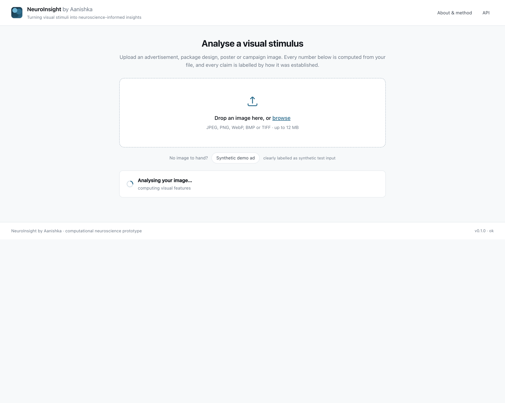
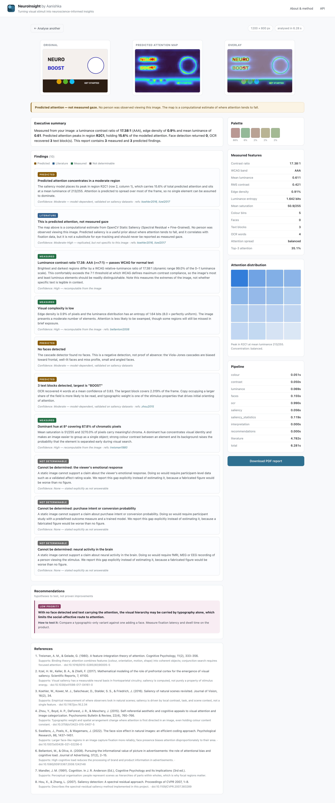
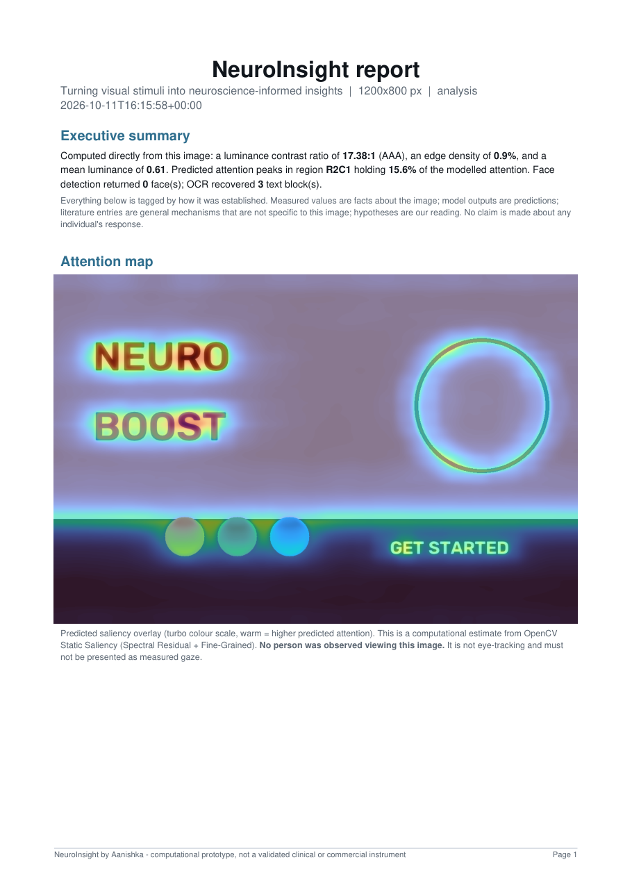

<div align="center">

# NeuroInsight by Aanishka

**Turning visual stimuli into neuroscience-informed insights**

An AI-assisted computational neuromarketing platform.
Upload an image · get a research-grounded report on its likely influence on
visual attention, perception and consumer interpretation.

[](https://www.python.org/)
[](LICENSE)
[](PROJECT_PLAN.md)

</div>

---

## Screenshots

**Upload**


**Results** — provenance badges, measured features, predicted-attention map, overlay,
live literature, pipeline timings, downloadable PDF.


**Generated PDF report** (5 pages, from a real run)


A complete sample report is committed at
[`docs/screenshots/sample-report.pdf`](docs/screenshots/sample-report.pdf).

> Screenshots are regenerated from live output by `scripts/screenshots.sh`. None are
> mocked up.

---

## The problem this project is about

Commercial "neuromarketing" tools routinely publish numbers like *engagement score*,
*emotional intensity* or *subliminal persuasion index* derived from a single image.
None of those numbers are recoverable from a picture. They require participant data —
eye-tracking, surveys, or brain recording — and a model trained and validated on that
specific outcome.

NeuroInsight is built around a simple refusal: **it will not produce those numbers.**
Instead it computes what genuinely *is* measurable from an image, separates that from
what a model merely predicts, and cites the neuroscience that connects the two.

## The core design decision

Every single finding in the report carries one of five provenance tags. This is enforced
in code — a finding cannot be created without one:

| Tag | Meaning | Example |
|:---|:---|:---|
| 🟢 **Measurement** | Computed directly from your pixels. Recomputable and exact. | "Contrast ratio 17.4:1" |
| 🟡 **Model output** | A prediction from a pretrained algorithm. An informed guess. | "Attention peaks in region R2C1" |
| 🔵 **Literature** | A mechanism established by published research. True in general, not about your image. | "Feature-integration theory predicts..." |
| 🩷 **Hypothesis** | Our reading. Plausible, unproven. | "Secondary elements may be missed at brief exposure" |
| ⚪ **Not determinable** | Cannot be established from a static image. We say so rather than guess. | "The viewer's emotional response" |

The last category is the point. Every report ends by explicitly declining to answer
what it cannot:

> **Cannot be determined: purchase intent or conversion probability**
> *This would require participant study with a predefined outcome measure and a trained
> model. We do not estimate it.*

Implemented in [`src/neuroinsight/provenance.py`](src/neuroinsight/provenance.py) — about
80 lines, and the file worth reading first.

## Quick start

```bash
git clone https://github.com/aanishkathacker/neuroinsight.git
cd neuroinsight

# macOS / Linux
uv venv && uv pip install -e .        # or: python -m venv .venv && pip install -e .

./scripts/serve.sh start              # → http://127.0.0.1:8000
```

No upload of yours leaves your machine. There are no API keys, no accounts and no
external model calls except a text query to Crossref for paper titles.

**One-off image analysis from the terminal:**

```bash
uv run neuroinsight analyse path/to/ad.jpg --pdf report.pdf
```

### Platform notes

| Feature | macOS | Linux | Windows |
|:---|:---|:---|:---|
| Saliency, faces, colour, contrast, PDF | ✅ | ✅ | ✅ |
| OCR | ✅ Apple Vision (built in) | ⚠️ needs `tesseract-ocr` | ⚠️ needs Tesseract on PATH |
| Sample image | ✅ bundled | ✅ bundled | ✅ bundled |

If no OCR engine is available the report says so explicitly rather than pretending the
image contains no text.

## Architecture

```
browser ──POST /api/analyse──►  FastAPI (uvicorn)
                                    │
                    ┌───────────────┴───────────────┐
                    │        vision/                │
                    │  features.py   (measurements)│
                    │  saliency.py   (prediction)  │
                    └───────────────┬───────────────┘
                                    │
                    ┌───────────────┴───────────────┐
                    │  provenance.py  (5-level tags) │
                    │  literature.py  (live Crossref)│
                    │  interpret.py   (findings)     │
                    └───────────────┬───────────────┘
                                    │
                 ┌──────────────────┴──────────────────┐
                 │  report/pdf.py  →  ReportLab PDF     │
                 │  web/static/    →  vanilla JS UI      │
                 └─────────────────────────────────────┘
```

* **Backend** — FastAPI, Python 3.13
* **Frontend** — vanilla JS, **no build step** (nothing to `npm install`, nothing to break)
* **Results store** — in-memory, capped at 24 analyses (local prototype only)
* **Dependencies** — numpy · scipy · OpenCV · ReportLab · Crossref API

### Measured pipeline timing

Per 1200×800 image on an Apple M4:

```
colour 0.05s · contrast 0.05s · luminance 0.06s · faces 0.15s
ocr 0.82s · saliency 0.06s · interpretation 0.00s · literature 1.86s
─────────────────────────────────────────────────────────────
total 3.07s
```

## Models used

| Role | Model | Source | Licence |
|:---|:---|:---|:---|
| Saliency | Spectral Residual + Fine-Grained | Hou & Zhang, CVPR 2007 (OpenCV contrib) | Apache-2.0 |
| Face detection | Viola-Jones Haar cascades | Viola & Jones, 2001 (OpenCV) | Apache-2.0 |
| OCR | Apple Vision / Tesseract | Apple; Tesseract project | Apple / Apache-2.0 |
| Literature | Crossref REST API | crossref.org | free API |

All are **pretrained or published algorithms** — nothing here was trained from scratch,
and nothing is claimed to be validated beyond its original publication.

See [`MODEL_CARD.md`](MODEL_CARD.md) for limitations of each.

## What this tool cannot do

- ❌ Measure emotion, purchase intent or subconscious response
- ❌ Estimate brain activity (no fMRI, no EEG, no eye-tracking)
- ❌ Replace a controlled consumer experiment
- ❌ Tell you whether your design will sell

It analyses **images**, not people.

## Roadmap

- [x] **M1** — End-to-end prototype, 10-stage pipeline, PDF report *(current)*
- [ ] **M2** — Visual hierarchy, object detection, AOI mapping, real sample gallery
- [x] **M3a** — **Statistical evaluation on MIT1003** (1,003 images): AUC 0.532, CC 0.208, **NSS 2.243**
- [ ] **M3b** — Pretrained deep saliency model, benchmarked against this baseline
- [ ] **M3c** — Webcam-based eye-tracking extension
- [ ] **M4** — Java validation component, Rust coordinate utility, public release, poster

## Project documentation

| File | Purpose |
|:---|:---|
| [`PROJECT_PLAN.md`](PROJECT_PLAN.md) | Milestones and progress |
| [`ARCHITECTURE.md`](ARCHITECTURE.md) | System design |
| [`RESEARCH_FOUNDATIONS.md`](RESEARCH_FOUNDATIONS.md) | Neuroscience evidence base |
| [`MODEL_CARD.md`](MODEL_CARD.md) | Models, licences, limitations |
| [`EVALUATION.md`](EVALUATION.md) | Evaluation protocol and **measured results** (MIT1003, n=1003) |
| [`LEARNING_LOG.md`](LEARNING_LOG.md) | Concepts learned while building |
| [`GLOSSARY.md`](GLOSSARY.md) | Terms explained |

## Author

**Aanishka Thacker** — Biology undergraduate, Ashoka University.
Built this as a learning project to explore the intersection of computational biology,
visual attention research and responsible ML practice.

## Licence

MIT — see [`LICENSE`](LICENSE).
Third-party models and data retain their own licences; see [`MODEL_CARD.md`](MODEL_CARD.md).

> **Disclaimer.** Research prototype. Not clinically validated, not a commercial
> neuromarketing system, and not a substitute for fMRI, eye-tracking or field
> experiments. Predicted attention should always be treated as a hypothesis to be tested.